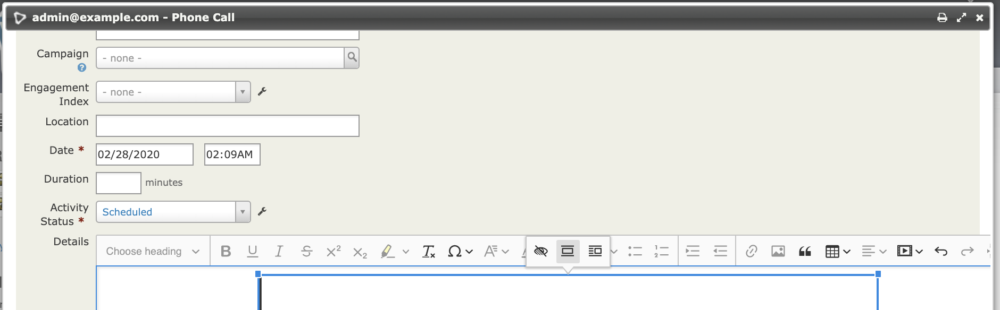
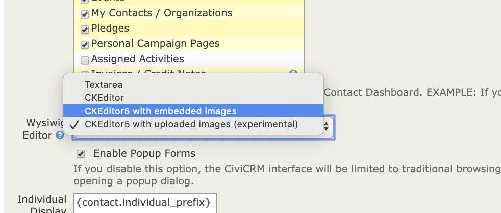

# CKEditor 5 for CiviCRM

[Source repository and issue tracker](https://lab.civicrm.org/extensions/ckeditor5)



This adds ckeditor5 as a usable Wysiwig in CiviCRM. Ckeditor5 is being actively developed while CkEditor4 is in LTS stage so it
makes more sense to invest time in ckeditor5 than ckeditor4. However both have gaps.
                                                    
Ckeditor5 is better than
ckeditor4 when it comes to inserting formatted text from word / google (note
that you no longer see the paste from Word button as you just paste).

Also note ckeditor5 always uses an expandable window so the field will be small if it has
no data.

This implementation gets away from  the kcfinder file manager  which was last  updated
in 2014. KcFinder was  brittle around paths - especially  for sites with non-standard layouts
like symlinks or Drupal8.

Currently the packaged version comes with 2 options:

* CKEditor5 with uploaded images (recommended) - works in the same way as
  ckeditor4 did, by storing the files on the filesystem. It uses the elfinder
  plugin (eventually we could add support for other storage backends).
* CKEditor5 with embedded images - useful for sites operating behind a firewall
  as it embeds any uploaded images into the html (as a base64 blob), meaning
  that images embedded in emails will not be inaccessible to the recipients.
  For example a user who is sending an email from CiviCRM from behind a firewall
  who wants to add a signature cannot use the traditional ckeditor4 image insert
  because the image will be located behind the firewall and inaccessible to the
  reader. By embedding it it will be available. However, this can have an impact
  on the size of the database.

Note - there are discrepancies between email clients and some
might suppress or mis-display embedded images, as some might suppress linked ones.

The extension is licensed under [AGPL-3.0](LICENSE.txt).

## Requirements

* CiviCRM **6.16 or later**, as declared in `info.xml`.
* PHP **8.1.2 or later**, compatible with the installed CiviCRM and CMS versions.
  This is the minimum required by [CiviCRM 6.16](https://github.com/civicrm/civicrm-core/blob/6.16.0/composer.json).
  Later CiviCRM or CMS versions may require a newer PHP version.
* For elFinder uploads, a writable CiviCRM image directory and a public image URL
  accessible to recipients when images are used in email.

## Installation (Web UI)

Open **Administer > System Settings > Extensions**. If a compatible release is
listed under **Add New**, install it there. Otherwise, use the manual or Git
installation instructions below.

## Installation (CLI, Zip)

Download an installable ZIP from the
[project releases](https://lab.civicrm.org/extensions/ckeditor5/-/releases), extract its `ckeditor5`
directory into the configured CiviCRM extensions directory, then enable the
extension through the Extensions page or `cv en ckeditor5` from the site root.

## Installation (CLI, Git)

Sysadmins and developers may clone the [Git](https://en.wikipedia.org/wiki/Git) repo for this extension and
install it with the command-line tool [cv](https://github.com/civicrm/cv).

```bash
cd <extension-dir>
git clone https://lab.civicrm.org/extensions/ckeditor5.git ckeditor5
cd <civicrm-site-root>
cv en ckeditor5
```

## Usage

After installation it is  available as an option under
Administer->Customize Data and Screens->Display Preferences



## Extending the editor configuration

### Per-field presets

The adapter reads the source field's `data-preset` attribute. Existing CiviCRM
forms already use `default`, `civimail` and `civievent`. Extensions may provide
additional names. Without configuration, all presets share the toolbar and
presentation-preservation policy described below.

### Presentation and template styles

The default configuration preserves classes, selected presentation attributes
and common inline CSS on supported text, image and table elements. It accepts
existing font families and sizes even when they are not in the toolbar choices.
Tables use CKEditor's open-source `PlainTableOutput` plugin, keeping dimensions
on the table rather than an email-incompatible `figure` wrapper.

The `civimail` preset inserts images as direct inline `img` elements instead of
block images wrapped in `figure`. Its resize control uses pixel widths and does
not expose block-image styles, preventing newly inserted email images from
returning to the browser-oriented figure markup. Exported images receive
explicit proportional dimensions, `height:auto`, `max-width:100%` and no
legacy border. Images which were not resized are capped at 600 pixels by
default; `civiEmailImageMaxWidth` can override that limit. Other presets retain
the full block and inline image toolbar.

`<style>` blocks and their media queries are retained through General HTML Support.
When loading a complete HTML document (`<!doctype>`, `<html>`, `<head>`, `<body>`),
the adapter preserves the document envelope (`<!doctype>`, `<html>` and `<head>`
metadata, `<style>` blocks, and `<body>` attributes) across visual edits and
Source Editing round-trips, while keeping fragment inputs as fragments.
`<style>` blocks remain inert in the editing canvas so template rules do not
bleed into the CiviCRM back-office UI.

To restrict an individual preset, set its `htmlSupport.allow` to your own list
(or `[]`), or choose the `presentation` or `strict` HTML ruleset in the preset
administration screen. Set `civiPreserveTemplateStyles: false` to disable
`<style>` block and document envelope preservation.

Run `node --test tests/*.test.cjs` for unit tests, or open
`tests/presentation.html` and `tests/shared-build.html` in a browser for
end-to-end CKEditor smoke tests.

### Configuring presets

An extension can register preset settings from its `html-header` resource hook:

```php
$items[] = ['config' => ['CKEditor5Presets' => [
  'default' => [
    'toolbar' => ['items' => ['bold', 'italic', 'link', 'undo', 'redo']],
  ],
  'civimail' => [
    'toolbar' => ['items' => ['bold', 'italic', 'link', 'insertTable', 'undo', 'redo']],
  ],
]]];
```

Configuration order is: built-in defaults, legacy `CKEditor5CustomConfig`,
saved admin defaults, `CKEditor5Presets.default`, saved named preset,
the named `CKEditor5Presets` override, then `crmCkeditor5Config` listeners.
The legacy global override still replaces top-level values. Presets merge nested
objects and replace arrays, including empty arrays; they never concatenate
toolbar items. Each editor receives independent configuration containers.

A missing or unknown preset falls back to the default configuration. Event
context `preset` identifies the field's requested preset (or `default` when
absent); `resolvedPreset` identifies the configured preset used, or `default`.
Listeners can therefore target `civimail` even without a registered preset.

Hiding a toolbar button does not prohibit its HTML in pasted or existing content.
This is configuration, not a permissions system or a CKEditor 4 config importer.
No editor rebuild is required for options supported by the included plugins.

### Preset administration

Administrators with `administer CiviCRM` can open **Administer > Customize Data
and Screens > CKEditor 5 presets** (`civicrm/admin/ckeditor5`). Clear CiviCRM's
cache after deploying to discover the new route, settings metadata and menu.

The page discovers presets from `wysiwyg_presets`. It stores per-domain settings
in `ckeditor5_presets`, published as `CRM.config.CKEditor5AdminPresets`.
Each section has an explicit customization checkbox; unchecked sections are
not stored and continue inheriting. Uncheck everything and save to reset only
the selected preset. Initial input examples are starting values, not a preview
of configuration modified by another extension.

- Toolbar: add, remove and reorder included buttons by dragging or with Up/Down.
  Separators may repeat. The file manager button is omitted in Base64 mode.
- Find and replace: choose a dialog (the default) or a toolbar dropdown.
- CiviCRM tokens: the optional `civiTokens` toolbar button searches the tokens
  available for the current editor preset and inserts one at the current
  selection. It is not enabled in the default toolbar because CiviCRM already
  provides a token selector on the relevant forms. The catalogue is loaded only
  when the picker opens. CKEditor does not maintain a token-name allowlist: the
  catalogue comes from CiviCRM's `TokenProcessor`, including tokens registered
  by enabled extensions. Its broad discovery schema can be extended by
  subscribing to the `civi.ckeditor5.tokenSchema` event and appending a context
  field to `$event->schema`.
- Fullscreen: choose whether its menu bar is visible and whether toolbar items
  remain ungrouped. CiviCRM defaults to no menu bar and an ungrouped toolbar.
  The sticky toolbar and contextual controls automatically stay below visible
  Drupal and CiviCRM administration menus. The elFinder dialog remains above
  the editor while fullscreen mode is active.
- Layout tables: choose automatic import detection or force unmarked external
  tables to content/layout type, and optionally strip the content-table figure.
  Existing unmarked tables default to content type for backward compatibility.
  Once edited, they receive the explicit `content-table` class used by CKEditor
  to preserve that distinction on subsequent loads.
  The default toolbar keeps a single table insertion button. Selecting a table
  exposes CKEditor's content/layout switch through the table properties control;
  `insertTableLayout` and `tableType` remain available to custom toolbars.
  The default build's `PlainTableOutput` already strips figures from all tables.
- HTML ruleset: choose `template` (preserve `<style>` blocks, classes and inline
  presentation styles), `presentation` (preserve classes and inline styles
  without `<style>` blocks), or `strict` (standard CKEditor schema only,
  recommended for presets shared with public or FormBuilder application forms).
- Image uploads and file manager: choose `elfinder`, `base64` or `none` (disable
  image uploads and file browsing for the preset). Users without both
  `access CiviCRM` and `access uploaded files` permissions never receive
  elFinder access and default to `none` when the site is in elFinder mode.
- HTML QA mode: compare the HTML received when an editor opens with the HTML
  immediately exported by CKEditor. The per-editor report inventories removed
  and generated elements, attributes, classes, inline styles and stylesheet
  blocks. This is an import/export diagnostic only; it does not add a filter,
  alter saved content or inspect later server-side processing.
- Font sizes: comma-separated integer pixel sizes and `default`.
- Palette: one `#RRGGBB | Label` per line, shared by text and table/cell colors.
- Styles: one `Name | element | class-one class-two` per line; add the `style`
  toolbar button to expose them. Supply the CSS separately in the editing and
  rendering contexts. Classes alone do not make styled email output; no CSS
  inlining, CSS injection or arbitrary HTML security-policy editor is included.

Programmatic named presets override saved options for the same context, and
configuration listeners retain final precedence. In particular, an extension
that unconditionally sets font sizes can override the admin selection.
Existing CKEditor 4 files are neither imported nor modified.

### Configuration event

Extensions can alter the CKEditor configuration for each source field before
the editor is created. Listen for the `crmCkeditor5Config` event, which bubbles
from the source textarea. The mutable configuration object and a context object
containing `uploadAdapter`, `preset` and `resolvedPreset` are passed to the listener:

```javascript
CRM.$(document).on('crmCkeditor5Config', function(event, config, context) {
  config.fontFamily = {
    options: [
      'default',
      'Arial, Helvetica, sans-serif'
    ],
    supportAllValues: true
  };

  if (context.uploadAdapter === 'elfinder') {
    // Apply configuration specific to the server-backed file manager.
  }
});
```

The listener may alter any option supported by the plugins already included in
the selected CKEditor build.

### Loading extension plugins without rebuilding the shared bundle

An extension can load local JavaScript and CSS after the shared CKEditor runtime
and before the first editor is created. Its JavaScript must use
`window.CKEDITOR`; it must not bundle its own copy of CKEditor modules.

Declare the assets from the `html-header` resource hook:

```php
$items[] = ['config' => ['CKEditor5PluginAssets' => [[
  'name' => 'my-extension',
  'scripts' => [CRM_Core_Resources::singleton()->getUrl('my_extension', 'js/ckeditor-plugin.js')],
  'stylesheets' => [CRM_Core_Resources::singleton()->getUrl('my_extension', 'css/ckeditor-plugin.css')],
  'plugins' => ['MyExtensionPlugin'],
]]]];
```

The plugin script registers its constructor against the exact shared runtime
version:

```javascript
(function(CRM, CKEditor) {
  class MyExtensionPlugin extends CKEditor.Plugin {
    static get pluginName() {
      return 'MyExtensionPlugin';
    }
  }

  CRM.ckeditor5.registerPlugin('MyExtensionPlugin', MyExtensionPlugin, {
    ckeditorVersion: CKEditor.version
  });
})(CRM, window.CKEDITOR);
```

Registered constructors are appended to `extraPlugins` before the
`crmCkeditor5Config` event, so a field listener can still remove or replace them.
Scripts load in declaration order; stylesheets load in parallel. Assets must be
same-origin URLs. A declaration can list expected plugin names in `plugins`; an
editor will not initialize if its script fails to register one of them.

This removes the central rebuild requirement for new extension-owned plugins.
A one-time shared build update is still required to expose `window.CKEDITOR`, and
the external plugin must be rebuilt when it needs APIs incompatible with the
shared CKEditor version.

## Limitations and browser support

- The editor language follows the current CiviCRM language in both ElFinder and Base64 modes. CKEditor 5 may not provide every CiviCRM language.
- Source editing is included, but CKEditor may normalize or remove unsupported
  markup when content is edited. Opening a complex email does not establish
  that an edit/save round trip will preserve its layout.
- Use a maintained, up-to-date browser. JavaScript ES6 support alone does not
  establish compatibility with the bundled CKEditor version. See CKEditor's
  [browser support policy](https://ckeditor.com/docs/ckeditor5/latest/updating/technology-upgrades-policy.html).
- Embedded Base64 images are not reliably displayed by every email client.
  Test the generated email in the clients used by your recipients.

## A word about builds

The extension ships one shared, self-hosted CKEditor 5 build for elFinder and
Base64 modes, under `js/ckeditor5/ckeditor-classic-build` (`ckeditor5` `49.0.0`).
Generated JavaScript and translations are tracked in this repository.

The existing `CKEditor5-elfinder` and `CKEditor5-base64` settings are preserved.
The adapter selects the upload plugins at initialization; it disables Base64
uploads in elFinder mode, and CKFinder integration in Base64 mode. elFinder's
own assets are loaded only in elFinder mode.

To rebuild the shared bundle, run:

```bash
cd js/ckeditor5/ckeditor-classic-build
npm ci
npm run build
```

## File management

- **elFinder mode** includes [elFinder](https://github.com/Studio-42/elFinder)
  and a CiviCRM connector. It supports uploading images and selecting existing
  files. Selected image URLs are inserted into the editor; other selected files
  can be linked. Uploads are stored on the server, not embedded in the HTML.
- **Base64 mode** embeds uploaded images in the HTML and does not provide a
  server-side file browser. New images are limited to 10 MiB and must decode
  successfully using the browser image decoder before they are embedded.
  Embedded images increase content and database size, and
  Base64 encoding increases the original binary size by roughly one third.

The shared build includes CKEditor's `CKFinder` integration plugin,
enabled only in elFinder mode: its command is intercepted by the CiviCRM adapter to open elFinder.
